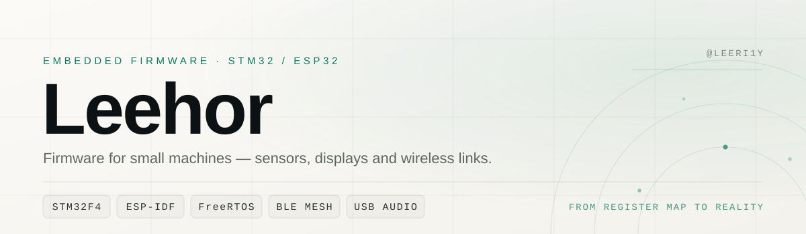

  <picture>
    <source media="(prefers-color-scheme: dark)" srcset="assets/hero-dark.svg">
    <source media="(prefers-color-scheme: light)" srcset="assets/hero-light.svg">
    
  </picture>

  <a href="#现在">现在</a> &nbsp;·&nbsp;
  <a href="#精选项目">精选项目</a> &nbsp;·&nbsp;
  <a href="#工具链">工具链</a> &nbsp;·&nbsp;
  <a href="#更多仓库">更多仓库</a> &nbsp;·&nbsp;
  <a href="#联系">联系</a>

---

我是 **Leehor**，GitHub 上叫 `Leeri1y`。电子 / 控制方向，日常和 C 语言、时序图、寄存器手册打交道。

比起调用现成的库，我更喜欢从 0 把一颗传感器、一块屏、一条无线链路跑通——看清时钟怎么配、数据怎么走、哪一步会卡死。所以这里大多是**可以直接烧进板子的工程**，README 里写清接线、时钟和踩过的坑。

> 先把时序跑对，再谈架构。

## 现在

- **2028 考研 · 控制工程（085406）** —— 自己写了一套每日打卡与进度系统 [kaoyan-2028](https://github.com/Leeri1y/kaoyan-2028)，每天在上面记录。
- **STM32F407 + FreeRTOS** —— 把 Arduino 版的 BNO086 九轴姿态仪表盘迁到 HAL：硬件 I2C1、SPI1 刷屏、IMU 与 UI 双任务。
- **FundLens Pro**（私有仓库）—— 基金 / 股票 / ETF 统一投资看板，Node + SQLite/Postgres + React，量化逐段拆解加 AI 解读。

## 精选项目

### 01 · 九轴姿态仪表盘
[bno086-motion-dash-stm32](https://github.com/Leeri1y/bno086-motion-dash-stm32)　`C` `STM32 HAL` `FreeRTOS` `BNO086` `ST7789` 
把 BNO086 运动仪表盘从 Arduino 完整移植到 STM32F407VET6：硬件 I2C1 读 IMU、SPI1 驱动 ST7789、双任务 + EXTI 按键、页面级报告订阅、Tare 校准，外加一条 I2C 卡死自恢复看门狗。

### 02 · STM32 入门教程源码
[STM32F103-Tutorial](https://github.com/Leeri1y/STM32F103-Tutorial)　`C` `Keil MDK` `StdPeriph` `STM32F103` 
40+ 个独立 Keil 工程，基于标准外设库，逐行中文注释：从 GPIO、定时器、ADC、DMA 一路到 I2C / SPI、RTC、低功耗与看门狗，配接线图。

### 03 · BLE Mesh 多灯控制系统
[ble_mesh_light](https://github.com/Leeri1y/ble_mesh_light)　`ESP-IDF v5.3` `BLE Mesh` `NVS` `SSD1306` 
五块 ESP32 跑同一份固件，用 nRF Mesh 配网与分组：开关、0–100% 无极调光、平滑渐变、NVS 持久化、多跳中继，每节点一块 SSD1306 显示状态。

### 04 · USB 双声道音频同步
[usbaudio_FreeRTOS](https://github.com/Leeri1y/usbaudio_FreeRTOS)　`ESP32-S3` `I2S` `USB Audio` `FreeRTOS` 
ESP32-S3 上的双设备音频同步：一块做 I2S 主机、一块做从机，用 FreeRTOS 对齐节拍，把 USB 音频送进两路输出。

### 05 · 软 SPI 驱动 RC522
[RFID-SoftSPI-Driver](https://github.com/Leeri1y/RFID-SoftSPI-Driver)　`Arduino` `SPI` `RC522` 
纯 Arduino 原生代码实现的软件 SPI，绕开 RC522 与 TFT 抢硬件 SPI 引脚的冲突；接口与常用库兼容，支持 Mifare 1K/4K 完整读写。

### 06 · 考研备考系统
[kaoyan-2028](https://github.com/Leeri1y/kaoyan-2028)　`JavaScript` `Node` `PostgreSQL` `Vercel` 
分阶段任务自动切换、每日打卡、按日期种子确定性抽词复习、金句与资料上传；零框架前端 + Node API，Vercel / Render / PostgreSQL 全免费栈。

## 工具链

**固件**　`C` `STM32 HAL` `StdPeriph` `ESP-IDF` `FreeRTOS` `Keil MDK` `STM32CubeMX` `LVGL`

**总线与外设**　`I2C` `SPI` `UART` `DMA` `EXTI` `PWM` `I2S` `USB Audio` `BLE Mesh`

**传感器 / 模组**　`BNO08x` `ICM-20948` `MPU6050` `RC522` `ST7789` `SSD1306` `W25Q64` `XPT2046`

**Web 与服务端**　`TypeScript` `React` `Vite` `Node` `SQLite` `PostgreSQL`

**工具**　`Git` `VS Code` `PlatformIO` `VOFA+` `nRF Mesh`

## 更多仓库

| 仓库 | 一句话 |
|---|---|
| [esp32-st7789](https://github.com/Leeri1y/esp32-st7789) | ESP32 触摸屏：ST7789 + XPT2046，LVGL 移植与 demo |
| [ICM20948-ESP8266](https://github.com/Leeri1y/ICM20948-ESP8266) | ICM-20948 的 DMP 姿态解算，从 MPU-9250 库改写 |
| [UART-send-receive](https://github.com/Leeri1y/UART-send-receive) | 串口文本数据包收发例程，STM32F103 标准库 |
| [aircondition](https://github.com/Leeri1y/aircondition) | 网页版「便携小空调」，仪表盘加白噪音助眠 |
| [match3-game](https://github.com/Leeri1y/match3-game) | 三消小游戏 |
| [brick-game](https://github.com/Leeri1y/brick-game) | 打砖块，带测试 |
| [super-breakout-game](https://github.com/Leeri1y/super-breakout-game) | 单文件打砖块 |
| [lucky-wheel](https://github.com/Leeri1y/lucky-wheel) | 移动优先的幸运大转盘，Canvas 高 DPI，落点与结果严格一致 |
| [Trash-Tools](https://github.com/Leeri1y/Trash-Tools) | C++ / C# 零碎小工具 |

## 数据

  
  
  
  

## 联系

想聊 STM32 / ESP32、驱动移植，或者某个项目跑不起来，直接在对应仓库开 issue 就行，我会看到。

---

Take it easy. — 一次把一个寄存器搞明白。

